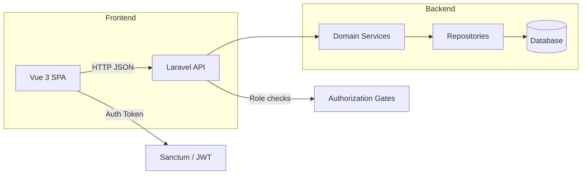
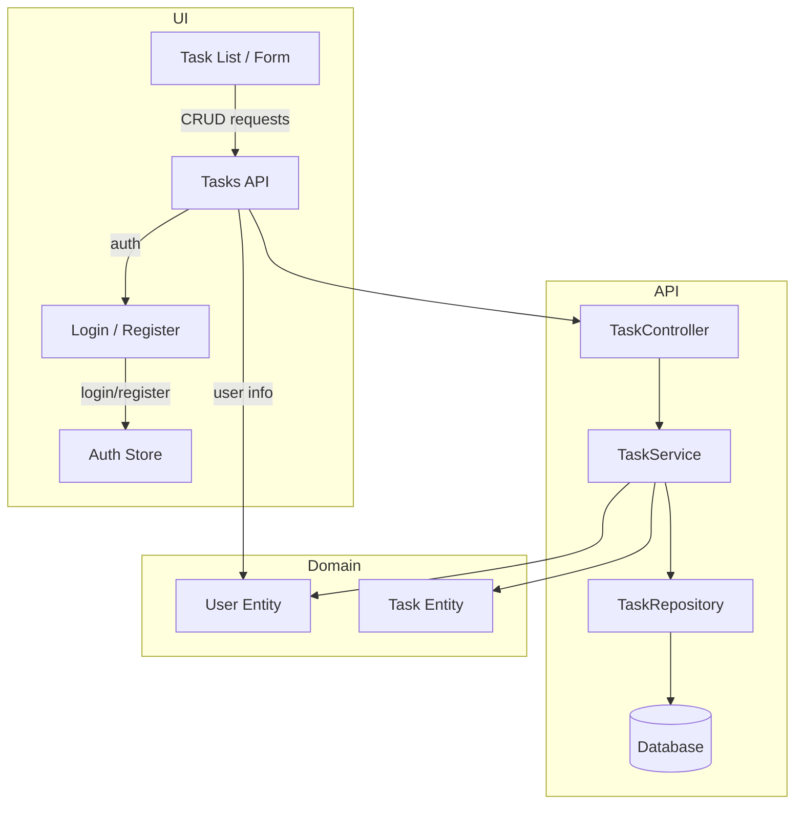

# Architecture Overview

This document describes the architecture of the Team Task Manager project, showing how the frontend, backend, and shared domain layers interact.

## System Overview

The application is structured as a monorepo with three main layers:
- `vue3/` frontend SPA
- `laravel12/` Laravel API backend
- `src/` shared domain and DDD abstractions

The frontend communicates with the backend API, while the backend owns persistence, authorization, and business logic.

## Domain and Data Flow

The backend follows a DDD-inspired separation of concerns. The `src/` directory contains shared domain concepts, while `laravel12/` implements API controllers and persistence.

## Key Architecture Principles

- `vue3/` handles presentation, routing, Pinia state, and UI flows.
- `laravel12/` handles authentication, authorization, validation, persistence, and API responses.
- `src/` contains shared domain models and abstractions that reflect the task/user business domain.
- API clients use JSON and standard REST routes, while the backend enforces role-based access control.
- The monorepo structure keeps frontend and backend aligned on tooling and developer workflows.

## Technical Decision Purposes

### Laravel package selection

- `laravel/framework`: provides the full application runtime, routing, service container, ORM, validation, and queue support needed for the API backend.
- `laravel/sanctum`: chosen for lightweight API authentication so the SPA can authenticate with tokens without introducing a heavier JWT stack.
- `laravel/fortify`: used to keep authentication flows such as login, registration, and password reset consistent and easy to extend without hand-rolling them.
- `laravel/boost`: used to improve AI-assisted development by keeping local project context indexed and current as the schema evolves.
- `laravel/pail`: selected to surface logs and application output during local development in a focused, low-friction way.

### Vue package selection

- `vue`: provides the reactive component model for the single-page application.
- `pinia`: chosen for state management because it is simple, TypeScript-friendly, and fits the small-to-medium app scope without Vuex’s boilerplate.
- `vue-router`: enables route-based navigation and protects pages through auth-aware guards.
- `axios`: chosen as the HTTP client because it supports request cancellation, interceptors, and predictable JSON handling for API calls.
- `vuetify`: selected as the UI component library so the app can ship a consistent Material-style interface quickly without building every component from scratch.
- `@mdi/js`: used to provide the icon set that meshes with Vuetify’s component styling and keeps the UI visually consistent.
- `vite-plugin-vuetify`: integrates Vuetify with Vite so component auto-imports and build behavior stay aligned with the modern frontend toolchain.

### Architecture-scope decisions

- The frontend and backend stay separate in the monorepo so each layer can evolve independently while sharing the same domain vocabulary.
- Shared domain types in `src/` are intentionally lightweight and language-agnostic in spirit, acting as a contract between the UI and API implementation.
- SQLite is used in local development to keep setup simple and fast while still approximating a MySQL-like environment through pragmatic pragmas.
- The use of strict TypeScript and alias-based imports is meant to reduce drift between the UI code and the shared domain structure as the app grows.
